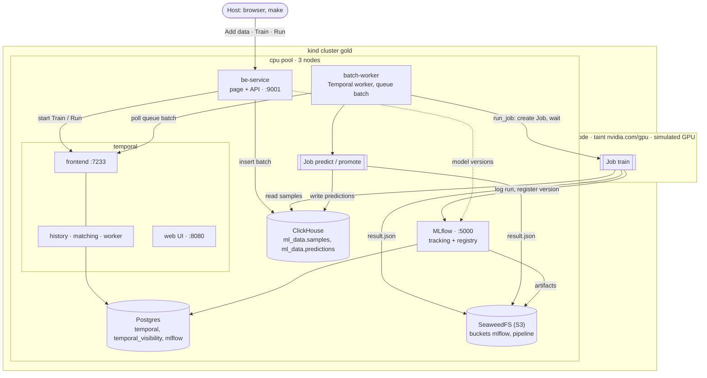
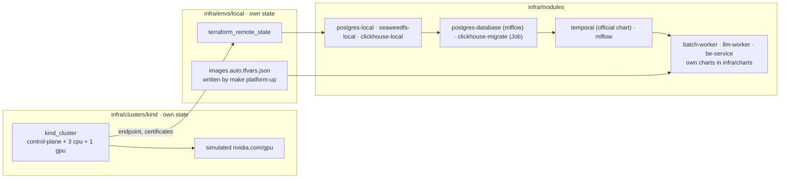

# ml-golden-stack

Reference stack for multi-model batch ML pipelines: OpenTofu, Kubernetes, Kueue and Temporal. Runs locally on kind and is designed to move to EKS or GKE by adding a cluster and an environment, without changing the service modules.

> The first end-to-end pipeline runs: a page with three buttons adds MNIST data, trains a model on the (simulated) GPU pool and runs it, through Temporal, Kubernetes Jobs, ClickHouse and MLflow. Kueue, the cloud environments and the items in [BACKLOG.md](BACKLOG.md) are next.

## Platform rules

The decisions the stack is built on, in the order they were made. Each rule says why it exists and where it is in the code; what is not built yet links to the backlog.

1. **Temporal orchestrates services across teams; it carries IDs, not data.** A workflow is the agreed process, each team implements its activities on its own task queue, and the contract is the names of workflows and activities and their payloads. Orchestration rather than choreography on purpose: a multi-step process that ends in a promotion decision has to be visible in one history. Data moves through ClickHouse and the object store.
   *Here:* be_service (Rust) starts workflows; batch_worker (queue `batch`) and llm_worker (queue `llm`), both Python, run them; payloads in the `src/workflow/contracts.py` of each worker. *Not yet:* one schema for Rust and Python ([Contracts](BACKLOG.md#contracts-between-be_service-and-the-workers)).

2. **Models are libraries behind a fixed API; the platform owns all I/O.** Data scientists build a model library against an agreed public API and test it on mock data; the platform wraps it into a Job. Both sides work in parallel, and the platform is tested end to end before a real model exists. A model is onboarded in four steps: run the notebook, keep its output as a golden test, move the code into the library, run it as a Job. It is accepted when the Job reproduces the notebook within an agreed tolerance.
   *Here:* `mle_models/src/mnist` (no I/O), `mle_models/src/jobs` (ClickHouse, MLflow, S3). *Not yet:* a model interface that lets `jobs` run any library by name, an image per model, conformance tests on mock data.

3. **Batch is the work of a model over a dataset, and it runs as a disposable Kubernetes Job.** Training a model, predicting or reporting over a dataset, indexing the whole corpus again for a new embedding model: such a step gets all its inputs as arguments, leaves its result in the object store and runs on any spot or GPU node of any cluster that meets the [cluster contract](#cluster-contract). The Job holds the heavy dependencies (torch) and the memory of the dataset, so the worker holds neither. A single event is never batch (rule 12).
   *Here:* `batch_worker/src/workflow/activities/run_job.py`, `mle_models/src/jobs`. *Not yet:* evictions not counted as failures, checkpoints ([Disruption tolerance](BACKLOG.md#disruption-tolerance)).

4. **Capacity is managed by the queue, not by services.** Kueue decides which Job runs where and when; a new cluster is an OpenTofu module plus a Kueue registration (MultiKueue across clusters).
   *Not yet:* planned, [Kueue](BACKLOG.md#kueue-queueing-pipeline-jobs).

5. **Every table has one own key and inherits the keys of its inputs.** The own key is the run that wrote the rows: the unit of rewrite and idempotency. Inherited keys are what the rows were made from, so lineage is a join. A key keeps its name in every table: the own key is `run_id` (`batch_id` for source data), an inherited one is `<parent>_run_id`. A run writes and rewrites only its own rows, never those of another run.
   *Here:* `db/clickhouse/migrations`. *What a wrong key costs:* `digit_report` was rewritten by its parent key, every new report deleting the previous ones by `prediction_run_id`, so an old report retried late wiped out a newer one. Fixing it took a chain, each patch exposing the next: the table became append-only; readers then needed a view to pick "the latest"; "the latest" by `created_at` turned out to be the time of the insert, not of the run, so a late retry won again; ordering by `run_id` instead would have required UUID v7 from every caller. The run registry (rule 11) settled it. Its own key was also named `report_run_id` against this rule (renamed by migration 0005, rule 10). *Not yet:* the source `batch_id` in `predictions` ([Lineage](BACKLOG.md#lineage)).

6. **Every step is idempotent; contracts are fixed, implementations replaceable.** Retries happen at three levels (activity, pod, Job) and must never run a step twice: a retry finds the Job it created, a partial write is deleted and written again, a complete one is skipped. With input and output fixed, the body of a step can be rewritten, by a person or an AI assistant, without touching the rest.
   *Here:* `run_job` (Job name from step and `run_id`), `write_predictions`, `be_service/src/ingest.rs`, with tests. *Not yet:* [idempotency gaps](BACKLOG.md#idempotency-of-pipeline-steps).

7. **Critical functions have an owner who can explain every line.** Anything that writes or deletes shared data or moves a pointer (ingest, writing predictions, promotion) is written or reviewed line by line by the platform team and tested against retries and partial failures. Moving blocks of the pipeline later is safe only when these are understood.
   *Here:* idempotency tests in `mle_models/tests`, `batch_worker/tests`, `llm_worker/tests`, `be_service/src/ingest.rs`. *Not yet:* CODEOWNERS, compare-and-set promotion ([Promotion safety](BACKLOG.md#promotion-safety)).

8. **Promotion policy lives in the workflow.** The train step reports metrics, the workflow decides: the policy changes without rebuilding the image, and every decision is in the workflow history. The same champion/challenger can later choose between versions of data, not only of models.
   *Here:* `batch_worker/src/workflow/train.py`, MLflow alias `champion`. *Not yet:* a fixed evaluation set as an explicit contract, data-level promotion.

9. **Two layers guard data quality.** CI runs the test cases that accumulate with every incident against every code change. In the pipeline, a validation gate before train and promote stops the workflow when the data breaks an invariant. CI catches regressions in code; the gate catches bad data that arrives while the code stays the same.
   *Here:* unit tests of all three services in CI. *Not yet:* the gate, an end-to-end run on kind in CI, a model quality threshold.

10. **Schema changes go expand, then contract.** Migrations run before the applications (`depends_on`), so a change must work with the previous release, including Jobs still running the previous image. Adding: migration first. Removing or renaming: code first, migration in a later release. An applied migration is never edited.
    *Example:* `digit_report.report_run_id` was named against rule 5. Migration 0005 (expand) adds `run_id` with `DEFAULT report_run_id`, so the previous image, which writes only `report_run_id`, keeps working and old rows read the right value; the current image writes both. The contract step comes in a later release: `MATERIALIZE COLUMN run_id`, `MODIFY COLUMN run_id REMOVE DEFAULT`, `DROP COLUMN report_run_id`, in this order, since ClickHouse refuses to drop a column another column's default depends on.

11. **A run exists for readers once it is committed to the run registry, and readers read only views.** A step writes its rows first and a marker in `ml_data.runs` last. Views join the data with the registry, so a run halfway through is never seen, and "the latest" run per parent is chosen by its logical start (when the workflow scheduled the step, the same on every retry), never by the time of an insert. The marker is written by the platform layer of whoever wrote the rows: the Job for batch work, the activity in the worker for stream work; never by model code, and the workflows do not change. `run_id` is unique across the platform and is the whole key of the registry, so a repeated commit merges away. Readers depend on views, writers on tables: a table can change its key or layout without any reader noticing. This is a small version of the snapshot commits of table formats such as Iceberg and Delta, and the way to them if the platform outgrows plain ClickHouse tables.
    *Here:* migrations 0006–0009, `commit_run` in `mle_models/src/jobs/clickhouse.py` (batch, `--started-at` from `run_job`) and in `llm_worker/src/workflow/activities/index.py` (stream, the activity's scheduled time); be_service reads `digit_report_latest`. *Not yet:* markers for batches, train reading committed batches only, views for the other reads of be_service, cleanup of uncommitted rows ([Run registry](BACKLOG.md#run-registry)).

12. **Events are a stream: processed in the worker as they come, against a model server.** An uploaded file and a chat message are each one small piece of work, done in seconds: starting a pod and loading a model for each would take longer than the work. They run as activities of the worker that call a long-running model server, a batch of chunks at a time, with a heartbeat after each, so the worker never holds more than one batch of vectors. The same operation over the whole dataset is batch again (rule 3): one uploaded file is indexed in the worker, the whole corpus for a new model in a Job. The model server is reached through one name in the cluster, `llm.llm.svc`, and one adapter with an OpenAI-compatible API, so the server (Ollama on the host, vLLM in the cluster, a managed endpoint) changes without changing the callers.
    *Here:* `infra/modules/llm-local`, `llm_worker/src/workflow/llm.py`, `index_file` in `llm_worker/src/workflow/activities/index.py`, `make llm-check`. *Next:* the chat answer ([docs/llm-plan.md](docs/llm-plan.md)); *not yet:* the corpus re-index as a Job.

13. **There are two release mechanics: one `tofu apply` for the MVP, GitOps for applications once the team outgrows it.** Today one apply of `envs/<name>` releases the infrastructure and the applications (`helm_release`) together: one dependency graph (migrations before applications), infrastructure outputs passed straight to the applications. A changed setting is an apply too, but only the resources whose values changed are updated, and a checksum of the settings on the pod rolls it. This fits one environment and a small team. The split comes when application releases queue behind the state lock, a second environment appears, or CI must not hold the whole state just to bump an image tag: OpenTofu keeps the infrastructure and installs Argo CD, Argo CD deploys the applications from the repo. To keep that move about a week of work, applications get the values the infrastructure owns (hosts, buckets, passwords) only through named ConfigMaps and Secrets, which stay the contract between the two layers, and nothing else of OpenTofu's goes into `helm_release` values.
    *Here:* ConfigMaps and Secrets `pipeline-job` in `infra/modules/batch-worker` and `llm-worker` in `infra/modules/llm-worker`, `checksum/settings` in those modules and in `infra/modules/be-service`. *Not yet:* Argo CD; model names, which the application owns, are still OpenTofu variables written into the `llm-worker` ConfigMap ([Drift detection](BACKLOG.md#drift-detection)).

## Layout

| Directory | Purpose |
|---|---|
| `infra/clusters/kind` | local kind cluster |
| `infra/modules` | cloud-agnostic modules, one service each: `postgres-local`, `postgres-database`, `temporal`, `seaweedfs-local`, `clickhouse-local`, `clickhouse-migrate`, `mlflow`, `llm-local`, `batch-worker`, `llm-worker`, `be-service` |
| `infra/charts` | Helm charts of our own applications: `batch-worker`, `llm-worker`, `be-service` |
| `infra/envs/local` | local environment: wires the modules onto the kind cluster |
| `db/clickhouse/migrations` | ClickHouse schema (golang-migrate, one statement per file) |
| `be_service` | Rust: the platform API and the MNIST page. Adds data to ClickHouse, stores uploaded files, starts workflows in Temporal (its only client) |
| `batch_worker` | Python: Temporal worker of the queue `batch`. Workflows `Train`, `Run`, `Report`, activity `run_job` that runs each step as a Kubernetes Job |
| `llm_worker` | Python: Temporal worker of the queue `llm`. Workflow `Index`, activity `index_file` that indexes an uploaded file in the worker; `rag` (chunking, no I/O); the LLM adapter |
| `mle_models` | Python: `mnist` (model code, no I/O) and `jobs` (the Job entry points: train, predict, report, promote) |
| `scripts/images.sh` | builds the application images and loads them into kind |

## Services

What runs in the local cluster. For which pod ran on which node in one real run, see [docs/example-scheme.md](docs/example-scheme.md). The pipeline itself is described in [docs/first-pipeline.md](docs/first-pipeline.md).



## Infrastructure layers



`clusters/*` and `envs/*` are separate OpenTofu root modules with separate state. An environment can be applied and destroyed without touching its cluster.

Everything cloud specific lives in `clusters/<name>` and `envs/<name>`:

| | kind (`envs/local`) | EKS / GKE (planned) |
|---|---|---|
| Cluster state | local file | S3 / GCS |
| Provider auth | client certificate | `aws eks get-token` / Google access token |
| Postgres | `modules/postgres-local` | RDS / Cloud SQL, same inputs to `modules/temporal`, `modules/postgres-database` |
| Object store | `modules/seaweedfs-local` (S3 API) | S3 / GCS: same endpoint, bucket and key inputs |
| ClickHouse | `modules/clickhouse-local` | ClickHouse Cloud, same inputs to `clickhouse-migrate` and the applications |
| Images | built locally, loaded into kind (`scripts/images.sh`) | pulled from GHCR, built by CI |
| UIs (page, Temporal, MLflow) | NodePort + kind port mapping | Ingress or internal LoadBalancer |
| History shards | 4 | 512 |
| GPU | simulated: fake `nvidia.com/gpu` on the `gpu` pool | real GPU node group; EKS: NVIDIA device plugin, GKE: built in |

Moving to a cloud means adding `clusters/eks` and `envs/eks` (or `gke`); `modules/*` stay as they are.

### Cluster contract

Every cluster must provide:

- worker pools labelled `node-pool=<name>`: `cpu` for platform services, `gpu` for model steps;
- GPU nodes tainted `nvidia.com/gpu=present:NoSchedule` and advertising `nvidia.com/gpu`;
- a default StorageClass;
- outputs: `endpoint`, `cluster_ca_certificate`, credentials for the providers.

Node selectors, tolerations and Kueue flavors written against this contract work unchanged in every environment.

## Local cluster

| Node | Pool label | Capacity label | Taint |
|---|---|---|---|
| control-plane | — | — | `node-role.kubernetes.io/control-plane:NoSchedule` |
| 3 × worker | `node-pool=cpu` | `capacity-type=on-demand` | — |
| 1 × worker | `node-pool=gpu` | `capacity-type=spot` | `nvidia.com/gpu=present:NoSchedule` |

Three `cpu` nodes let replicated services run one replica per node. Pools, sizes, labels and taints are configured through the `node_pools` variable.

### Simulated GPU

The `gpu` pool has no real GPU. Its nodes advertise a fake `nvidia.com/gpu` resource (set by `infra/clusters/kind/scripts/setup-gpu-nodes.sh` after the cluster is created) and carry the label `gpu-simulated=true`.

GPU pods request `nvidia.com/gpu` and tolerate the taint exactly as on cloud GPU nodes, so their manifests and Kueue flavors are the same everywhere. They schedule locally but run on CPU: model code has to fall back to CPU when no CUDA device is present.

### Exposed services

NodePort → `127.0.0.1`:

| Service | URL |
|---|---|
| Pipeline page (be_service) | http://127.0.0.1:9001 |
| Temporal UI | http://127.0.0.1:8080 |
| MLflow | http://127.0.0.1:5000 |

ClickHouse and SeaweedFS stay inside the cluster; use `kubectl port-forward` for a look (see below).

### Requirements

- [OpenTofu](https://opentofu.org/docs/intro/install/) ≥ 1.8
- Docker (Podman works with `KIND_EXPERIMENTAL_PROVIDER=podman`)
- kubectl
- ~6 GB of free RAM: cluster, platform services and a running train Job
- Linux: raised inotify limits, see below

The `kind` CLI is not required: the cluster is created by the `tehcyx/kind` provider.

`make infra-up` runs `make preflight` first: it checks the tools, the docker daemon, inotify limits and free memory. It never changes the host, it prints what to run to fix what is missing.

#### inotify limits

Every kind node runs its own kubelet, containerd and kube-proxy, all using inotify on the host kernel. Distro defaults (usually 128 instances) are enough for about three nodes. With more, kube-proxy crashes with `too many open files` and pods lose access to services and DNS ([kind known issue](https://kind.sigs.k8s.io/docs/user/known-issues/#pod-errors-due-to-too-many-open-files)). Raise the limits once (asks for sudo, writes `/etc/sysctl.d/99-kind.conf` so they survive reboots):

```bash
make host-setup
```

### Usage

```bash
make infra-up          # create the cluster
make platform-up       # build and load the images, install platform services and applications
export KUBECONFIG=$PWD/infra/clusters/kind/.kubeconfig
make infra-status      # nodes, pools, taints, GPUs
make platform-status   # all pods and pipeline Jobs

make platform-down     # always before infra-down
make infra-down
```

`make platform-up` is the one command for everything above the cluster. It builds the three application images, tags them by content (`dev-<image id>`), loads into the kind nodes only what they miss, and applies `infra/envs/local`. A changed image gets a new tag and its pods roll; with nothing changed the apply is a no-op. `make platform-up IMAGES=remote TAG=sha-abc1234` takes the images CI published to GHCR instead.

Do not run `make` with sudo: OpenTofu state written by root cannot be updated later without it. `make` refuses to run as root, and every target that runs OpenTofu first checks (`make check-owner`) that its files belong to you, printing the `chown` that fixes them. If docker needs sudo, give your user access to docker instead (`make preflight` says how).

The kubeconfig is written to `infra/clusters/kind/.kubeconfig` (gitignored), so `~/.kube/config` is left untouched.

## Pipeline

Open http://127.0.0.1:9001 and press the buttons in order, or use make:

```bash
make add-data N=5000   # be_service adds the next 5000 MNIST examples as one batch
make train POOL=gpu    # workflow Train: Job train on the gpu pool, promote if better
make run               # workflow Run: the champion predicts all 10,000 test images
make report            # workflow Report: what the recognized digits add up to
```

Adding data and training again shows the point of the demo: accuracy grows with the data (about 64% on 1,000 examples, 95% on 10,000, 98.5% on all 60,000), and a new version becomes `champion` only when it beats the current one.

| Step | Who | Where the result goes |
|---|---|---|
| Add data | be_service, directly | `ml_data.samples`, one `batch_id` (UUID v7) per batch |
| Train | Temporal `Train` → batch_worker `run_job` → Job `train` | MLflow run + new version of `mnist-cnn`, `result.json` |
| Promote | decided in the workflow, Job `promote` | MLflow alias `champion` |
| Run | Temporal `Run` → Job `predict` | `ml_data.predictions` under the run's `run_id` |
| Report | Temporal `Report` → Job `report` on the latest prediction run | `ml_data.digit_report`: per digit, how many the model recognized and how many there are; every report is kept, the page reads the latest per prediction run through the view `digit_report_latest` |

Contracts that hold the pieces together:

- `batch_id` and `run_id` are generated by be_service per button press and travel through the workflow input, the Job arguments, ClickHouse and MLflow (`train_batches.json` lists the batches a model was trained on).
- Workflow IDs are fixed (`train`, `run`, `report`): a second press while one runs is refused by Temporal.
- `run_job` names the Job `<step>-<run_id>`: a retried activity finds the Job it created instead of starting the step again. Every step is idempotent: a partial batch or prediction run is rewritten, a complete one skipped.
- The `mnist` package has no I/O; `jobs` does ClickHouse, MLflow and S3 around it.

## Retrieval

Files uploaded through the platform API become chunks with embeddings in ClickHouse; the chat (the next slice of [docs/llm-plan.md](docs/llm-plan.md)) answers from them.

```bash
make upload FILE=README.md   # stored in the object store, a row in ml_data.files, workflow Index
make files                   # every file with its index state: indexing, indexed (chunks, model), failed
```

| Step | Who | Where the result goes |
|---|---|---|
| Upload | be_service: checks (text, up to 10 MiB, UTF-8), sha256 as `file_id`, object store, then `files` | `pipeline/files/<file_id>`, `ml_data.files` |
| Index | Temporal `Index` → activity `index_file` in the worker (no Job, rule 12): chunks of about 1,000 characters, embedded 32 at a time by the LLM server | `ml_data.doc_chunks` under the run's `run_id`, marker `kind='index'`; readers use `doc_chunks_current` |

The same bytes uploaded again return the file already there. A file is indexed again with `POST /api/files/<file_id>/index`: after a failure, or with a new embedding model, whose vectors live next to the old ones until the new index is committed.

## Platform services

### Data and models

| Service | Module | Notes |
|---|---|---|
| ClickHouse 26.8 | `clickhouse-local` | low-memory config (512 MiB cap, system log tables off); schema only from `db/clickhouse/migrations` |
| ClickHouse migrations | `clickhouse-migrate` | stock `migrate/migrate` image, SQL from a ConfigMap; a new migration file means a new Job, nothing runs otherwise |
| SeaweedFS 4.48 | `seaweedfs-local` | single `weed server` with the S3 gateway; a Job creates the buckets |
| MLflow 3.17 | `mlflow` + `postgres-database` | own database and user in Postgres, artifacts in SeaweedFS through the server, `mlflow db upgrade` as an init container, background job execution off (~2 GiB less) |

ClickHouse and SeaweedFS from the host:

```bash
kubectl -n clickhouse port-forward svc/clickhouse 8123:8123     # http://127.0.0.1:8123/play
kubectl -n clickhouse get secret clickhouse -o jsonpath='{.data.password}' | base64 -d   # user: platform
kubectl -n seaweedfs port-forward svc/seaweedfs 8888:8888       # filer UI: http://127.0.0.1:8888
```

### LLM server

The model server runs on the host, not in kind: the GPU is not passed into the cluster yet, and weights in the host's VRAM cost the cluster no memory. The cluster reaches it as `http://llm.llm.svc` (`modules/llm-local`: a Service without a selector and an EndpointSlice pointing to the host).

Ollama, installed once without sudo, listening only on the kind bridge so the rest of the network cannot use it:

```bash
curl -fsSL https://ollama.com/download/ollama-linux-amd64.tar.zst | tar x --zstd -C ~/.local
mkdir -p ~/.config/systemd/user && cat > ~/.config/systemd/user/ollama.service <<'UNIT'
[Unit]
Description=Ollama, listening only on the kind bridge

[Service]
Environment=OLLAMA_HOST=172.18.0.1:11434
ExecStart=%h/.local/bin/ollama serve
# The kind bridge appears only after docker creates it: retry until it does.
Restart=always
RestartSec=5

[Install]
WantedBy=default.target
UNIT
systemctl --user daemon-reload && systemctl --user enable --now ollama

export OLLAMA_HOST=172.18.0.1:11434
ollama pull qwen3:4b   # chat, ~2.5 GB of VRAM
ollama pull bge-m3     # embeddings, multilingual, 1024 dimensions, ~1.2 GB
make llm-check         # one answer and one embedding from inside the cluster
```

The models are variables of `envs/local` (`llm_chat_model`, `llm_embed_model`): another chat model is `ollama pull` and a new name. Another embedding model also needs every file indexed again, since vectors of different models cannot be compared.

### Applications

| Application | Chart | Runs |
|---|---|---|
| be-service | `infra/charts/be-service` | one replica (Add data is serialized in-process), NodePort 30901 |
| batch-worker | `infra/charts/batch-worker` | Role to create, watch and delete Jobs and read pod logs in `batch-worker` only |
| llm-worker | `infra/charts/llm-worker` | none: no Role, no service account token in the pod |
| pipeline Jobs | created by `run_job` | `train` on the `gpu` pool (toleration + `nvidia.com/gpu: 1`), `predict` and `promote` on `cpu`; `ttlSecondsAfterFinished: 3600` |

### Temporal

| Part | How it runs |
|---|---|
| Server (frontend, history, matching, worker) | official `temporalio/temporal` chart, one replica each |
| Persistence and visibility | Postgres from `modules/postgres-local` in the `postgres` namespace, databases `temporal` and `temporal_visibility` |
| Schema | created and migrated by the chart's schema job (pre-install / pre-upgrade hook) |
| Namespaces | `default` with 3 days retention, created by the chart's namespace job |
| UI | http://127.0.0.1:8080 (NodePort 30080) |
| Frontend for workers | `temporal-frontend.temporal.svc:7233` |

`modules/temporal` takes the database as inputs (`db`, `db_password`) and knows nothing about where it runs. Locally it gets the in-cluster Postgres, in the cloud a managed database. Postgres lives in its own namespace for the same reason: to Temporal it is an external database, as RDS would be.

All platform pods are pinned to `node-pool=cpu`. Local Postgres has no replication and no backups. Its password is generated by OpenTofu, stored in the state and in the `postgres` and `temporal-db` Secrets.

`numHistoryShards` is 4 locally and cannot be changed after the first install without recreating the database (`make platform-down && make platform-up`).

For a quick check from the host:

```bash
kubectl -n temporal port-forward svc/temporal-frontend 7233:7233
temporal workflow list --address 127.0.0.1:7233
```

## Versions

| Component | Version | Why |
|---|---|---|
| `tehcyx/kind` provider | `~> 0.11` | bundles kind v0.31 |
| Kubernetes node image | `v1.35.0` | default image of kind v0.31, pinned by digest |
| `temporalio/temporal` chart | `1.7.0` | server 1.32.0, UI 2.54.1 |
| Postgres | `17.11-alpine` | |
| ClickHouse | `26.8.25.14` | LTS |
| SeaweedFS | `4.48` | MinIO was archived in 2026 |
| MLflow | `3.17.0` (`-full` image) | `psycopg2` and `boto3` included |
| golang-migrate | `v4.20.1` | |
| Temporal SDKs | Python `temporalio` 1.34, Rust `temporalio-client` 1.1 | |
| PyTorch | 2.14 (CPU wheels) | |
| `hashicorp/helm` provider | `~> 3.3` | |
| `hashicorp/kubernetes` provider | `~> 3.3` | |
