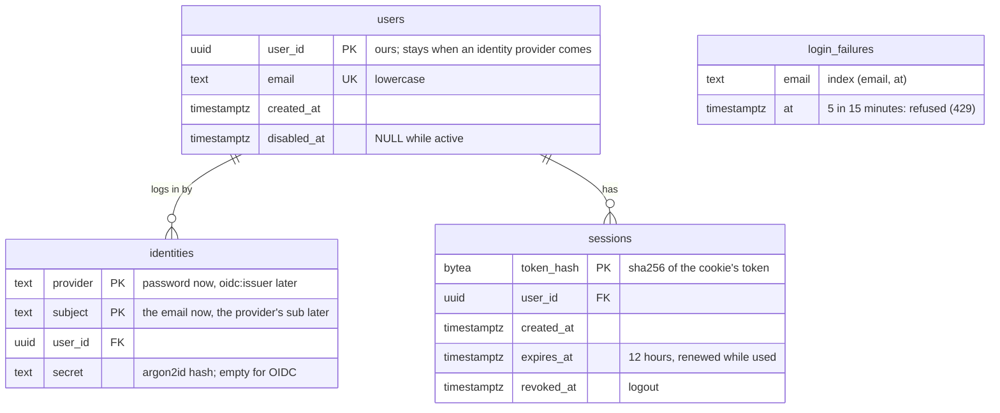
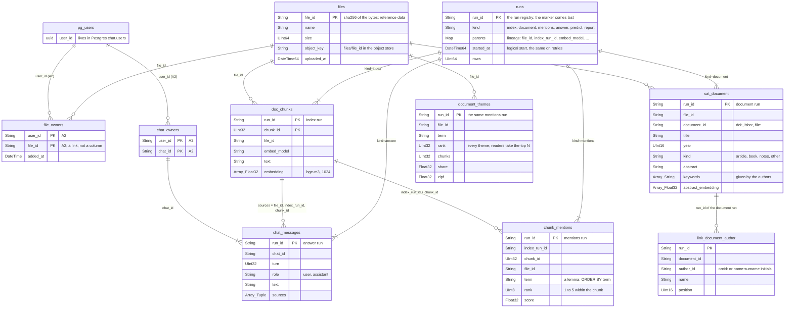
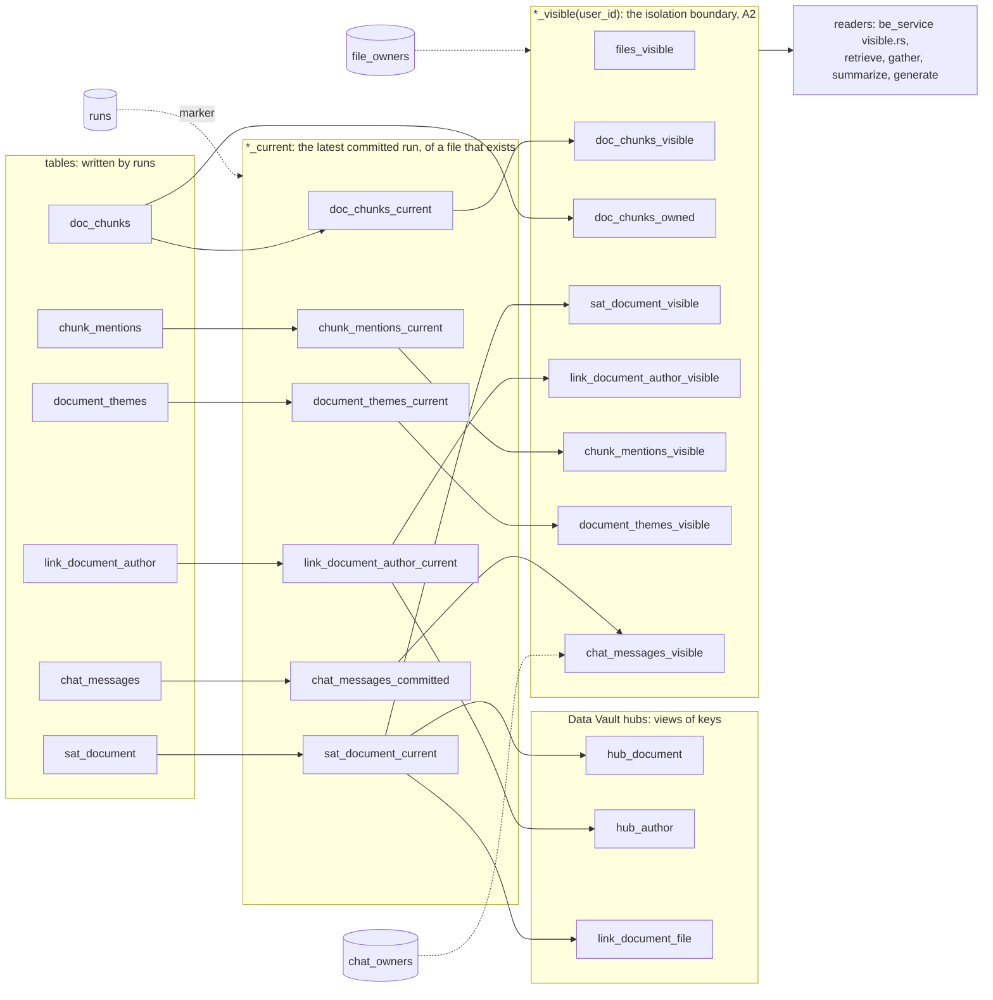

# Data model

The stores of the platform and what lives in each, as it stands after the login stage ([auth-plan.md](auth-plan.md)). Tables and views marked **A2** are planned, not built yet; the rest is in `db/clickhouse/migrations`. The MNIST tables (`samples`, `predictions`, `digit_report`) are left out: the login stage does not touch them.

Two stores, by what the data needs:

- **Postgres** (database `chat`, owned by chat_service): users, how they log in, sessions. Data that changes in place and needs transactions and point reads.
- **ClickHouse** (database `ml_data`): files, the outputs of runs and what readers see of them. Append-only rows under the `run_id` of the run that wrote them (rule 5), seen through views over the run registry (rule 11).

## Postgres: `chat` (A1)

A user is our own `user_id`; how they log in is an identity. An identity provider later is another row in `identities` for the same `user_id`, so nothing that refers to users changes.

## ClickHouse: `ml_data`, tables

Relations are logical: ClickHouse has no foreign keys, and tables join on keys that keep their name in every table (rule 5).

## ClickHouse: layers of views

- **Writers write tables only**, each row under the `run_id` of its run, the marker in `runs` last.
- **`*_current`** leaves out runs halfway, runs replaced by a newer one, and files deleted since (rule 11).
- **Hubs** (`hub_document`, `hub_author`, `link_document_file`) are views of the keys of current runs and have no table of their own: their keys are found by a model, so a key of a failed or replaced run must not stay visible.
- **`*_visible(user_id)`** (A2) is all that be_service and the steps of an answer read: a user sees a file only through their own link in `file_owners`.
- **`doc_chunks_owned`** (A2) reads texts by key from every run, of the user's files only: an index committed while an answer is being written must not hide the chunks the answer is built from.
