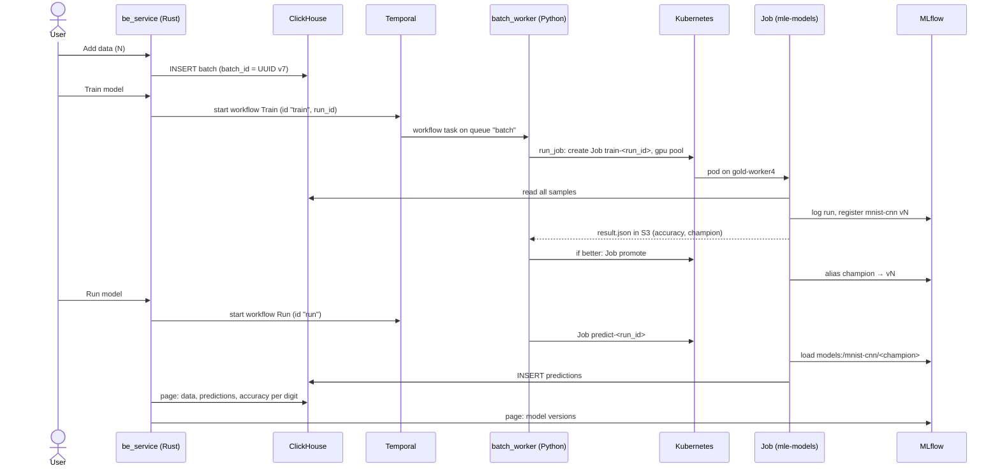

# First pipeline: add data, train, run, report

A page with four buttons drives an MNIST classifier through every layer of the stack. Small on purpose: the value is in what happens behind the buttons.

| Button | What happens | Result |
|---|---|---|
| **Add data** | be_service inserts the next N MNIST training examples as one batch | rows in `ml_data.samples` under a new `batch_id` |
| **Train model** | workflow `Train` → Job `train` on the `gpu` pool, then Job `promote` if the new model is better | MLflow run and a new version of `mnist-cnn`; alias `champion` |
| **Run model** | workflow `Run` → Job `predict` | 10,000 rows in `ml_data.predictions` under the run's `run_id` |
| **Report** | workflow `Report` → Job `report` on the latest prediction run | `ml_data.digit_report`: how many of each digit the model recognized, next to how many there are |

Report answers "so what?" after recognition: the recognized digits are counted, and a digit the model leans towards (say, too many 8s, because it reads some 3s and 2s as 8) shows up as a bar past its true count. It is a separate workflow, not a step of Run: the same contract (`run_job`, one more subcommand in the image) carries a new kind of step without any platform change.

Adding data and training again is the demo: accuracy goes from ~64% on 1,000 examples to ~95% on 10,000 and ~98.5% on all 60,000.

## Flow

## Decisions

| Decision | Why |
|---|---|
| be_service (Rust) is only a Temporal client; batch_worker (Python) runs the workflows | the API scales with HTTP load, workers with queue backlog; a worker deploy does not take the API down. Rust and Python share nothing but the workflow name, the task queue and the JSON input |
| Add data goes straight from be_service to ClickHouse, Train and Run go through Temporal | inserting a batch is one short call; training is long, needs a GPU, retries and a visible history |
| Every step is a Kubernetes Job of the mle-models image | isolation, its own image (torch ~1 GB), scheduling on the `gpu` pool by the cluster contract, later queueing through Kueue. The worker stays small |
| `mle_models/src/mnist` has no I/O, `mle_models/src/jobs` does it | DS code is a pure API: tested without services, reusable outside the pipeline |
| Promotion is decided in the workflow | the policy changes without rebuilding the image, every decision is in the workflow history |
| `batch_id` / `run_id` generated by be_service, workflow IDs fixed | data identity versus run identity. The ids travel through the Jobs, ClickHouse and MLflow (lineage); the fixed workflow ID blocks a second Train while one runs |
| Idempotent steps | Temporal retries activities. The Job name comes from the step and `run_id`, so a retry finds the existing Job; a partial batch or prediction run is rewritten, a complete one skipped |
| Results travel through `result.json` in S3, not pod logs | logs disappear with the pod and get truncated |
| ClickHouse for data and predictions | append-only data, full scans for training, aggregates for the page: an OLAP load |
| MLflow for models, with downloads proxied through the server | tracking and registry instead of own tables; Jobs need only the MLflow URL, no S3 access |
| Migrations as a Job before the applications | schema shared by two applications, so it belongs to neither chart; one statement per file because ClickHouse DDL is not transactional |

## Where the code is

| Directory | Contents |
|---|---|
| `be_service/` | axum API and the page (`static/index.html`), ClickHouse ingest, Temporal client, MLflow REST |
| `batch_worker/src/workflow/` | `Train`, `Run`, `Report`, `contracts.py`, `activities/run_job.py` |
| `mle_models/src/` | `mnist` (IDX reader, CNN, train/predict, digit report), `jobs` (train, predict, report, promote) |
| `db/clickhouse/migrations/` | `ml_data` and its tables |
| `infra/charts/`, `infra/modules/` | how the applications and services are deployed |

## Limits of this version

- One be_service replica: Add data is serialized by an in-process lock.
- The `gpu` pool is simulated; training runs on CPU there.
- Jobs are scheduled directly; Kueue would queue them by pool quota.

These and the rest are in [BACKLOG.md](../BACKLOG.md).
